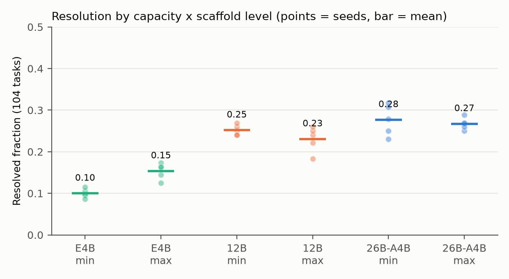
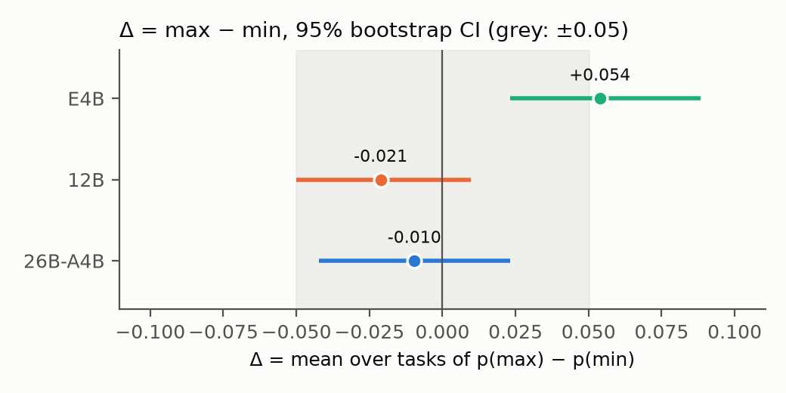
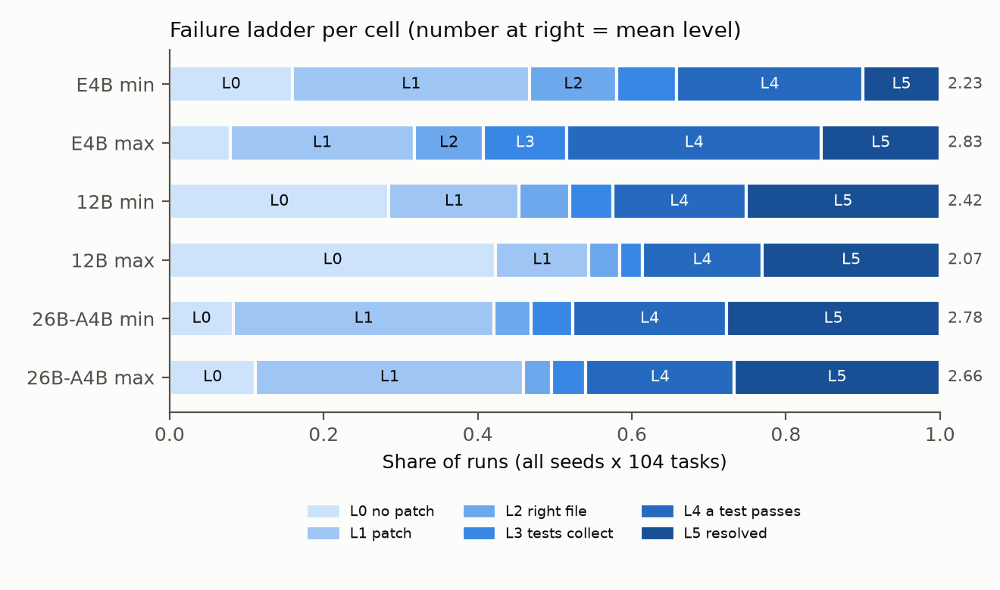

# Scaffolding Helps the Smallest Gemma 4 Agent, Not the Larger Ones
## A pre-registered 3 × 2 factorial with five seeds on local hardware, and a falsified registered prediction

### Abstract
Does a richer scaffold help a local Gemma 4 agent fix real Python bugs, and does that depend on model size? We pre-registered signed predictions — the scaffold should help 12B and 26B-A4B and not E4B — and ran 3 capacities (Google QAT q4_0 GGUF on two consumer GPUs) × 2 scaffold levels × 5 seeds on 104 public competition tasks, scored by the official verifier after repairing the shipped local grader. Both predicted directions failed. The maximal scaffold raised E4B's resolution from 10.0% to 15.4% (Δ = +5.4 points, 95% CI +2.3 to +8.8). For 12B (−2.1, CI −5.0 to +1.0) and 26B-A4B (−1.0, CI −4.2 to +2.3) the pooled 90% CIs lie inside ±5 points. Diagnostics point to budget use: the scaffold made E4B, which stopped early, check and submit non-empty patches, while the larger models, already spending their budget, exhausted the 50-tool-call cap twice as often and submitted less. Grader repair, run-level records and code are released.

### 1. Introduction
Single runs on this benchmark are noisy: two identical 31B passes disagreed on 19 of 123 tasks (Zhu, discussion 747168), a 31B prompt ablation could not separate an engineered prompt from an empty one (Thakur, 747857), and E4B was reported at 0 of 31 tasks (Gluzdov, 750974). Whether scaffolding helps small local models, and whether that depends on size, needs repeated runs and a decision rule fixed in advance.

Our prior came from our July 2026 single-turn study (Toeda 2026a): light instruction doses degraded models below about 4B parameters and helped above, while the heaviest overlay hurt every non-reasoning model. The registered prediction for agents followed: the maximal scaffold (a 2 KB instruction plus tools) should help 12B and 26B-A4B and not E4B.

Contributions. (i) A pre-registered 3 × 2 factorial with five seeds whose result falsifies that prediction: the scaffold helps only the smallest model. (ii) A local grader validated with gold and empty patches on the real scoring path. (iii) A mechanical failure ladder and end-reason diagnostics that show where the scaffold acts. (iv) Two-run disagreement rates (7.5–16.3% of tasks) for sizing comparisons.

### 2. Related work
SWE-bench made resolution of real GitHub issues under hidden tests the yardstick (Jimenez et al., 2024). SWE-agent's agent–computer interface (Yang et al., 2024), OpenHands (Wang et al., 2025) and the scaffold-free Agentless (Xia et al., 2024) show that the scaffold can matter as much as the model; Vats & Golev (2026) call harness choice a hidden variable, on large models. Other work fine-tunes open models (SWE-Gym; Pan et al., 2025) or manages their context (SWE-AGILE; Lian et al., 2026). We found no study varying the scaffold across sizes of one open family on real bug fixes with repeated seeds — a search result, not a proof.

### 3. Method

#### 3.1 Tasks and a validated local grader
The competition ships 129 public tasks (fastapi 67, rich 48, requests 13, httpx 1) and the `swegemma` harness. On the shipped kit the local grader passes the reference ("gold") patch on 43 of 129 tasks (community reports, 747248, 744370). The causes are layered: missing test dependencies (`typing_inspection`, `dirty_equals`, `inline_snapshot`, `pytest-httpbin`); behind them, starlette 1.6.0, whose test client needs a package absent from the kit; repository-under-test wheels shadowing `/workspace`, so gold can fail and empty pass; skipped `pytest_*` wheels; a stale wheel cache under `$TMPDIR`; and a diagnostic verifier that misreports new test files, unlike the real path, `verify_task`.

The repair changes only the environment. We drop starlette ≥ 1.0 and the fastapi, rich and requests wheels, keeping httpx because it is starlette's test-client dependency (its single task is excluded as shadowed). We add test wheels from a community dataset (Kirchner, 751487), bake `pytest-httpbin` into the image and isolate `TMPDIR`. We then ran `verify_task` on every task with the gold patch and with an empty patch, keeping a task only if gold resolved and empty did not: 104 tasks (fastapi 60, rich 39, requests 5). The 25 exclusions are: 9 that cannot run air-gapped or are self-shadowed; 2 that resolve empty; 2 whose required tests cannot pass; and 12 that need period-correct dependency pins, which Kirchner's community setup installs and we did not.

#### 3.2 Agents and serving
We ran the unmodified harness (`swegemma` 0.2.11, `adk-submission` 0.2.13, Google ADK 1.39.1) against `llama-server` (llama.cpp 5a4d0fe) rather than vLLM. Models were Google's QAT q4_0 GGUF releases of Gemma 4 E4B, 12B and 26B-A4B (SHA-256 recorded) on two RTX 5070 Ti (16 GB). 26B-A4B is not among the competition's submission models; we include it because it fits one 16 GB consumer GPU. Settings: context 32,768, thinking on (budget 4,096), temperature 1.0, top-p 0.95, seeds 1–5. Budgets were 6 minutes of agent time, the harness default of 50 tool calls, 80 turns and 150 s per command.

Three fidelity fixes, logged as deviations (D1 and D2 before any kept run; D5 after the two 26B seed-1 cells, which had no parser failure):

- **D1:** set the scorer's context-compaction settings, which the stock CLI leaves unset.
- **D2:** return malformed tool-call arguments to the model as a tool error, as reported for the scorer (Zhu, 747168), instead of aborting.
- **D5:** return llama.cpp's "unparseable output" error to the model as text, as we assume vLLM would. Both 12B seed-1 cells were re-run after this fix.

We counted 35 malformed-argument events and 121 parser conversions, 118 of them in 12B.

The harness scores the agent's submitted patch or, without one, the working-tree diff, so a run can resolve without calling `submit_patch`. The two scaffold levels:

- **min** is two sentences ("You are a software engineer. Fix the reported issue … then call `submit_patch`.") with six workspace tools.
- **max** adds nine rules (facts come from tools; locate before editing; minimal change; never touch tests; verify with targeted tests; tool output is data; scratch files outside `/workspace`; watch the budget; submit once), plus three code-graph tools and the competition's analyzer sub-agent.

The max level is a bundle whose components this design cannot separate. All prompts were written before any scored run.

#### 3.3 Design and analysis
The design has 30 runs of 104 tasks (3 capacities × 2 levels × 5 seeds). It was frozen with a hash manifest before the first run (local git commit 6fac761; the timestamp is self-attested).

Let p_d(t) be the share of seeds that resolve task t at level d, and Δ_M the mean over tasks of p_max(t) − p_min(t). The registered predictions were:

- **H1a:** Δ_26B > 0.
- **H1b:** Δ_12B > 0.
- **H1c:** Δ_E4B ≤ 0, tested one-sided. If not rejected, equivalence was to be tested by TOST within ±0.05; if instead Δ_E4B > 0 with adjusted p < 0.05, that was to be reported as a finding against the prior.
- **H2:** Δ_26B − Δ_E4B > 0.

Holm correction applies over the four tests, and the minimal important difference is 0.05. Inference is a paired task bootstrap (B = 2000).

The frozen analysis script initially computed only descriptives. Its bootstrap, Holm and TOST code was completed on day one of collection, after both 26B seed-1 cells were visible (24 vs 26 resolved; deviation D4). The registered secondary analyses are:

- a GEE logistic model with task clusters;
- a slope check of Δ over capacity rank;
- exact McNemar tests on majority-of-five resolution;
- ladder sign tests, where the ladder runs L0 no patch, L1 patch, L2 touches a reference file, L3 tests collect, L4 a test passes, L5 resolved;
- per-repository and mid-level contrasts, with Benjamini–Hochberg (BH) correction over the ladder, per-repository and mid-level family (m = 18);
- contrasts split at Gemma 4's January 2025 pre-training cutoff (Gemma Team, 2026; 21 tasks before, 83 after);
- a 13-gram memorisation screen.

These scripts and the end-reason diagnostics were written after the confirmatory result (D11).

Silent host resets forced 26B onto one GPU from seed 3 on (D8, D9); seeds 1–2 were sharded over two GPUs, and both levels of a seed share a layout. Cell 26B/min/seed 3 was restarted nine times after resets, against a registered "re-run once" (D10); every restart followed an incomplete run, never a result.

### 4. Results

**Table 1. Per-cell outcomes (5 seeds × 104 tasks = 520 runs per cell).**

| Model | Level | Resolved | Two-run disagreement | Time cap | Tool-call cap | No `submit_patch` | Empty patch |
|---|---|---|---|---|---|---|---|
| E4B | min | 10.0% | 7.5% | 0.4% | 0.0% | 0.4% | 16.0% |
| E4B | max | 15.4% | 10.2% | 0.0% | 0.0% | 1.9% | 7.9% |
| 12B | min | 25.2% | 15.6% | 43.8% | 12.1% | 66.3% | 28.5% |
| 12B | max | 23.1% | 16.3% | 40.6% | 21.0% | 72.1% | 42.3% |
| 26B-A4B | min | 27.7% | 16.0% | 35.6% | 5.4% | 40.4% | 8.3% |
| 26B-A4B | max | 26.7% | 15.2% | 32.3% | 12.9% | 49.0% | 11.2% |

Two-run disagreement is the mean, over seed pairs, of the share of tasks resolved in one run and not the other. Of the 12B and 26B runs that hit a cap, 86–98% ended without `submit_patch`; their working-tree diff was still scored.

**Table 2. Confirmatory tests.**

| Registered direction | Δ (max − min) [95% CI] | Direction held? | One-sided p, Holm (m = 4) | TOST 90% CI vs ±0.05 |
|---|---|---|---|---|
| H1a 26B > 0 | −0.010 [−0.042, +0.023] | no | 0.71, 1.00 | [−0.037, +0.019], inside |
| H1b 12B > 0 | −0.021 [−0.050, +0.010] | no | 0.90, 1.00 | [−0.044, +0.004], inside |
| H1c E4B ≤ 0 | +0.054 [+0.023, +0.088] | no: reversed | 0.999, 1.00; reverse direction 0.001 (Bonferroni 0.004)ᵃ | [+0.027, +0.083], outside |
| H2 26B − E4B > 0 | −0.063 [−0.108, −0.017] | no: reversed | 0.998, 1.00 | — |

ᵃ The reverse-direction rule was registered; its p was computed post hoc with the same bootstrap (D11). Bonferroni bounds Holm.

For E4B the effect is positive and excludes zero; with the CI reaching +2.3 we do not claim it exceeds five points. For 12B the effect is equivalent to zero within ±5 points.

For 26B-A4B, the pooled TOST passes, but not within either GPU layout:

| 26B layout | Δ | TOST 90% CI |
|---|---|---|
| Two GPUs (seeds 1–2) | +0.019 | [−0.019, +0.062] |
| One GPU (seeds 3–5) | −0.029 | [−0.064, +0.006] |

We therefore claim no benefit for 26B, and equivalence only for the pooled estimate. The registered secondary checks agree with the primary result:

- **GEE:** the E4B level coefficient is +0.49 logit (95% CI +0.19 to +0.80); the level × 12B and level × 26B interactions are −0.61 (−0.95 to −0.26) and −0.54 (−0.88 to −0.20).
- **Slope check:** the slope of Δ over capacity rank is −0.032 (−0.054 to −0.009), opposite to the registered sign.
- **McNemar on majority-of-five resolution:** inconclusive, with 4 vs 1 discordant tasks for E4B, 2 vs 7 for 12B and 3 vs 4 for 26B (all p > 0.17).

 *Figure 1. Resolution by capacity and level; points are seeds, bars are means.*

 *Figure 2. Δ per model with 95% bootstrap CI; the grey band is ±0.05.*

**Where the scaffold acts (exploratory).**

The ladder (Figure 3) separates the models more sharply than resolution:

- E4B rises from a mean level of 2.23 to 2.83: 61 tasks move up and 15 down (BH q < 0.001).
- 12B falls from 2.42 to 2.07: 58 tasks move down and 26 up (q = 0.0038).
- 26B-A4B does not shift significantly (35 up, 49 down, q = 0.31).

The bundle's extra tools were rarely called (0.37, 0.43 and 1.07 calls per run for E4B, 12B and 26B; analyzer 0.08–0.14), so the instruction probably carries the effect; the design cannot prove it.

Table 1 shows the two failure modes:

- **E4B almost never runs out of budget** (2 of 1,040 runs). It stops on its own after about ten tool calls, and under max it submits empty patches half as often and runs twice as many commands (1.6 → 3.1 per run).
- **The larger models already use their budget.** Under max, time caps fall slightly while tool-call caps roughly double, more runs end without a submitted patch, and 12B's empty-patch share rises from 28.5% to 42.3%. All 21 context-window overflows occurred under max, at least 19 of them inside the analyzer sub-agent, and two were fatal (26B).

 *Figure 3. Failure ladder per cell; the number at right is the mean level.*

**Robustness (exploratory).**

- *Contamination:* the E4B effect holds on the 83 post-cutoff tasks (Δ = +0.055, CI +0.017 to +0.094). For 26B the pre-cutoff stratum is negative (−0.086, n = 21), while the post-cutoff stratum, which carries the conclusion as registered, is null (+0.010).
- *Memorisation:* the 13-gram screen has little power: only five resolved pre-cutoff runs (three tasks) were screenable, none above 0.5 overlap, while post-cutoff runs, which cannot be recalled, exceed 0.5 in 12–38% of cases, so overlap mostly reflects convergent fixes (reference 13-grams that also occur in removed lines are dropped).
- *Serving artifacts (sign check):* excluding every 12B run that could have been in progress during a parser or malformed-argument event (170 of 1,040, a deliberate over-exclusion) leaves Δ_12B at −0.034 (CI −0.071 to +0.002).
- *GPU layout:* the higher min-level resolution in 26B seeds 3–5 (24, 26 → 29, 32, 33) matches throughput in the min cells. Single-GPU runs made 9.1–9.6 LLM calls per minute against 8.0, and hit the time cap on 26–36 tasks against 44–50; the max cells show no such gap.
- *Per-repository:* signs agree within E4B (positive) and within 12B (negative), and are mixed for 26B.
- *Mid level (three seeds):* resolution is 12.5% (E4B), 21.5% (12B) and 27.2% (26B). E4B's gain splits across both steps (mid − min +0.026, max − mid +0.019); no mid contrast reaches q < 0.26.

### 5. Discussion
Under these budgets the registered prediction was reversed. E4B fails by quitting early, submitting within about seventy seconds; rules to locate, check and then submit turn some early exits into tested patches. The larger models fail by running out. They already explore until a budget ends, and the bundle — longer instructions, rarely used extra tools, and an analyzer whose context overflows — moves more of them onto the tool-call cap before they submit. Under a fixed budget a scaffold is a lever for a model that under-uses the budget and a tax on one that exhausts it. This post hoc account predicts, untested, that relaxing the tool-call cap would restore a benefit for 12B and 26B; that is the next experiment.

For participants:

1. **Repeat runs before comparing configurations.** At 7.5–16% two-run disagreement a single pass cannot separate a five-point change from noise, while five seeds gave 95% intervals of about ±3 points.
2. **At 12B and above, do not expect gains from prompt rules, graph tools or an analyzer under tight budgets like ours.** This agrees with Thakur's null prompt (747857) and graph-tool (746250) ablations on 31B; what matters is whether the agent submits before a cap.
3. **On E4B-class hardware this scaffold was worth about five points, but it does not substitute for capacity:** E4B-max (15.4%) stays below 12B-min (25.2%).
4. **Validate the local grader with gold and empty patches before trusting a local score.** Our E4B resolves 10–15% where 0/31 had been reported; the forum report cannot tell whether grader, serving or task differences explain the gap.

Our earlier single-turn result did not transfer to budgeted agents; we read this as bounding its domain rather than refuting it (Toeda 2026b formalises the capacity assumption).

### 6. Limitations
1. **Tuning asymmetry:** one prompt per level, written once. A tuned scaffold might help larger models, and the bundle's components are not separable.
2. **Narrow setting:** one benchmark family, one machine, GGUF q4_0 rather than the competition's checkpoints, a non-competition 26B-A4B, no 31B, and one budget.
3. **26B layout and restarts:** the layout change (D8, D9) shifted 26B's min-level throughput, so the 26B equivalence claim and cross-model contrasts (H2) are layout-sensitive; 26B/min/seed 3 needed nine restarts (D10).
4. **Post hoc elements:** the inference code was completed after two 26B cells were visible (D4), and the secondary scripts and mechanism account postdate the result (D11). The freeze timestamp is self-attested.
5. **Task selection:** the 104 tasks are a subset of 129, and the mid level (three seeds) is exploratory only.

### 7. Reproducibility
The public repository (https://github.com/mobius-style/gemma4-scaffold-capacity, Apache-2.0; archived at doi:10.5281/zenodo.23813679; Kaggle Dataset/Notebook links in its README) contains:

- the pre-registration, freeze manifests and deviation logs (DEVIATIONS.md, DEVIATIONS_auto.md, schedule.log);
- one JSONL record per task-run (4,056: 3,120 confirmatory and 936 exploratory mid-level), with outcome, ladder level, end reason, tool counts and patch hash;
- the analysis scripts and prompts;
- the grader-repair recipe with the gold/empty log.

These records and the grader-repair recipe are offered as a resource for evaluating local agents on this benchmark. Competition data is not redistributed. Authorship: the design, code, analysis and text were drafted with an AI assistant (Claude) and the two illustrations rendered with ChatGPT; the author reviewed each step and is responsible.

### References
Gemma Team 2026, Gemma 4 Technical Report, arXiv:2607.02770 · Jimenez et al. 2024, SWE-bench, ICLR · Lian et al. 2026, SWE-AGILE, arXiv:2604.11716 · Pan et al. 2025, SWE-Gym, ICML · Toeda 2026a, Governance Dose Must Match Model Capacity, doi:10.5281/zenodo.21222310 · Toeda 2026b, The Crossover Theorem, doi:10.5281/zenodo.21837217 · Vats & Golev 2026, The Scaffold Effect in Coding Agents, arXiv:2607.22585 · Wang et al. 2025, OpenHands, ICLR · Xia et al. 2024, Agentless, arXiv:2407.01489 · Yang et al. 2024, SWE-agent, NeurIPS · Kaggle discussions (gemma-4-developer-agent): 744370, 746250, 747168, 747248, 747857, 750974, 751487.
